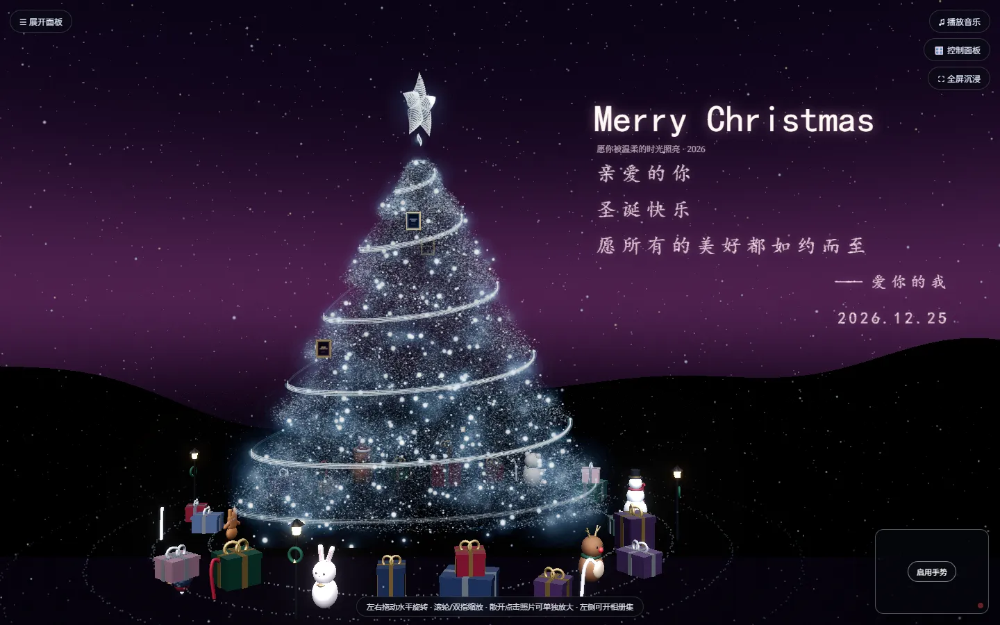
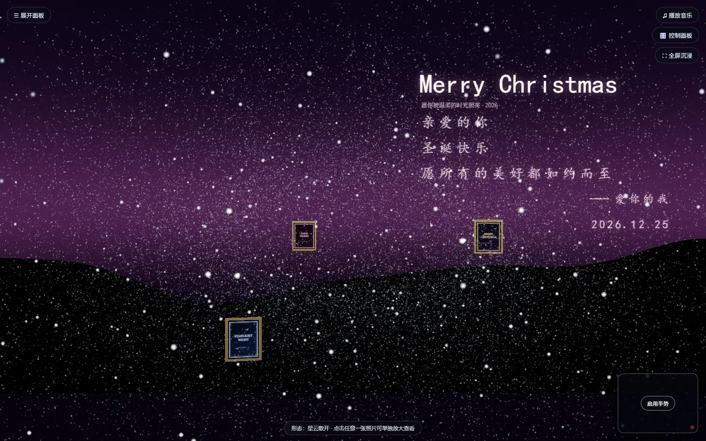
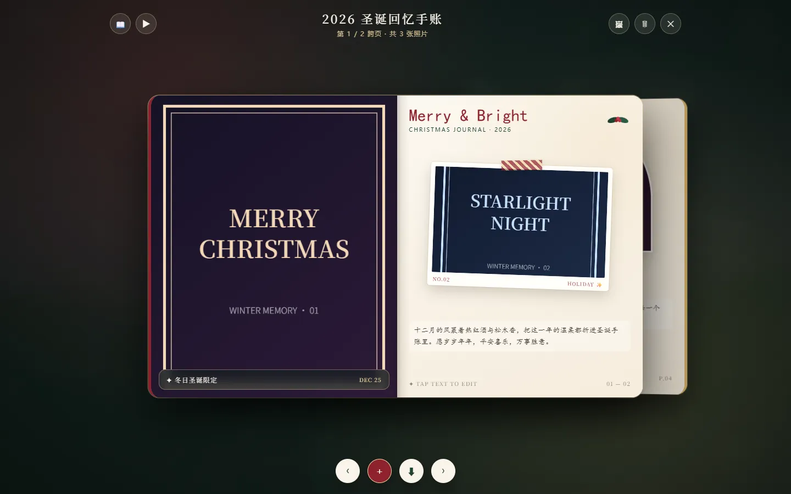

# 星钻圣诞树 · Starlight Christmas Tree

用 Canvas 和 Three.js 实时绘制的互动圣诞树。可以拖动银白粒子树、用手势聚散星光，也可以把自己的照片排成一本可翻页的圣诞手账。

[查看中文制作教程](TUTORIAL.md) · [在本机运行](#在本机运行)

## 聚拢 · 星钻圣诞树



> **Merry Christmas**<br>
> 愿你被温柔的时光照亮 · 2026
>
> 亲爱的你<br>
> 圣诞快乐<br>
> 愿所有的美好都如约而至<br>
> —— 爱你的我<br>
> 2026.12.25

## 散开 · 星光与照片



## 相册集 · 圣诞回忆手账



效果图来自实际运行的桌面网页。相册中的示例卡片由程序生成。

## 能玩什么

| 功能 | 体验 |
| --- | --- |
| ✦ 星钻圣诞树 | 五角星由银线绕出，细粒子排成一层层枝裙。螺旋灯带流动，背景有星光和烟花。 |
| ↔ 拖动和旋转 | 鼠标或触屏左右拖动树，松手后继续自动旋转。 |
| 📖 圣诞回忆手账 | 添加自己的照片，手机左右滑动时纸页跟着手指绕书脊翻转。短滑会回弹，点照片可放大。 |
| ✋ 相机手势 | 在控制面板开启。握拳聚拢、张手散开、捏合打开相册。相册打开后暂停手势识别，直接用触屏或鼠标浏览。 |
| ♪ 音乐与祝福 | 可切换默认音乐或选用本机音频，在控制面板选择是否显示开场祝福，也可以进入全屏模式。 |

## 在本机运行

准备 Node.js 20 或以上和 Python 3，在仓库根目录运行：

```sh
npm ci
npm run build
python -m http.server 8080 --bind 127.0.0.1 --directory dist
```

打开 <http://127.0.0.1:8080/>。修改 `index.html` 后重新构建并刷新。相机手势需在控制面板开启、授予浏览器相机权限，并联网加载 MediaPipe Hands。

| 文件 | 内容 |
| --- | --- |
| [index.html](index.html) | 完整可读源码，包含样式、绘制、音乐、手势和相册 |
| [TUTORIAL.md](TUTORIAL.md) | 从树形到触屏相册的制作步骤和代码定位 |
| [build.mjs](build.mjs) | 将 Three.js 与页面打包到 `dist/index.html` |
| [package.json](package.json) / [锁文件](package-lock.json) | 构建命令和固定版本依赖 |

## 相册和相机数据

照片与自选音乐保存在当前浏览器的 IndexedDB，文案和相册偏好保存在 localStorage。相机图像在浏览器中处理。默认音乐和相册封面由代码生成。

本项目源码使用 [MIT 许可证](LICENSE)。Three.js、esbuild 和外部加载的 MediaPipe、字体按各自上游许可使用。
